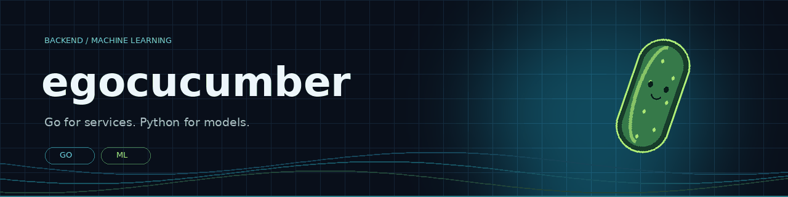
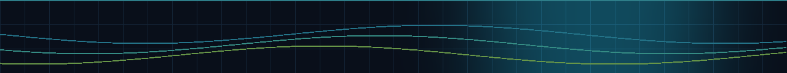

 

 

## Achievements

**Winner of the AgroTech accelerator.**

**Winner of Center-invest Bank's “Artificial Intelligence for Sustainable Development Goals” competition.**

 

## What I build

Go backend services, distributed systems, and applied ML tools.
My projects range from event-driven telemetry and background job processing
to code refactoring and retrieval-augmented generation.

 

## Toolbox

**Backend & infrastructure**

  
  
  
  
  
  

**Machine learning & AI**

  
  
  
  
  
  

 

## Featured · RefactorAI

> Bringing Go and machine learning together to help improve source code.

A graduation project for code analysis and ML-assisted refactoring:
a Go API for processing repositories, a Python inference service
with a LoRA adapter, and a React interface for reviewing suggestions.

**Go · Python · PyTorch · Transformers · PEFT · FastAPI · React**

  

## Backend systems

| Project | What it does | Stack |
| :--- | :--- | :--- |
| [**telemetry-platform**](https://github.com/egocucumber/telemetry-platform) | Industrial telemetry ingestion, processing and alerting | `Go` `gRPC` `Kafka` `TimescaleDB` `Redis` |
| [**goqueue**](https://github.com/egocucumber/goqueue) | Distributed background jobs with streaming workers, retries and a dead-letter queue | `Go` `gRPC` `PostgreSQL` `Redis` `Kafka` |
| [**rate-limiter**](https://github.com/egocucumber/rate-limiter) | Token Bucket and Sliding Window implementations with HTTP middleware | `Go` |
| [**proc-monitor**](https://github.com/egocucumber/proc-monitor) | Real-time Linux process monitoring directly from /proc | `Go` `Linux` |

 

## Applied AI

| Project | What it does | Stack |
| :--- | :--- | :--- |
| [**ExaLore**](https://github.com/egocucumber/rag-exalor) | Document Q&A with retrieval-augmented generation | `Python` `FastAPI` `LangGraph` `ChromaDB` |
| [**Virtual Editorial Team**](https://github.com/egocucumber/multil) | Research, writing and iterative editing through an agent workflow | `Python` `LangGraph` `Streamlit` |

 

